<div align="center">


<br/>

[](https://github.com/workforakng)

<br/>

[](https://www.linkedin.com/in/ak-n-g)
[](https://github.com/workforakng)
[](https://twitter.com/Ak_N_G)
[](https://ak-n-g.github.io)
[](mailto:workforakng@gmail.com)

</div>

---

## ⚡ About Me

<details align="right">
<summary>📋 Copy About Me</summary>

```text
Name: Akshar Nath Gorain
Role: Systems Engineer & AI Researcher
Education: B.Tech CSE, 3rd Year @ Techno India University
Location: Kolkata, India 🇮🇳
Stacks: Full-Stack, Computer Vision, Model Compression, Edge AI
Philosophy: Build systems that matter. Research that makes impact. Code that solves real problems.

Currently focused on:
- 🐾 Building CURAA — cross-platform mobile architecture & intelligent pet-care ML pipelines
- 🧠 Researching Knowledge Distillation and Computer Vision
- ⚡ Building production-grade systems in healthcare, blockchain, and automation
- 🏅 AI-ML Virtual Internship @ AICTE × EduSkills — completed (Grade O, Aug–Oct 2026)
- 🤖 Enterprise AI Engineering (RAG, Vector Search & MCP) @ AICTE × EduSkills — in progress
- 🐍 Programming in Python @ Meta (Coursera) — in progress
```
</details>

<picture>
  <source media="(prefers-color-scheme: dark)" srcset="dark.svg">
  
</picture>

---

## 🛠️ Tech Arsenal

<div align="center">

**Languages**


**Frontend & Mobile**


**Backend & Infra**


**Data, ML & AI**


</div>

---

## 🚀 Flagship Projects

<table>
<tr>
<td width="50%" valign="top">

### ❤️ HeartSense
**Contactless rPPG vital-signs biometrics**
- 100% on-device screening of 5 vital signs
- CameraX locked capture + 478-landmark MediaPipe
- POS/CHROM DSP with adaptive Kalman tracking at 60 FPS
- Zero cloud dependency; native clinical PDF report

`Kotlin` `Jetpack Compose` `MediaPipe` `DSP`

</td>
<td width="50%" valign="top">

### 🛡️ VaaniKavach
**On-device AI voice clone scam defense**
- Distilled AASIST anti-spoofing running on TFLite
- Multilingual coercion detection (Bengali / Hindi)
- Tamper-evident SHA-256 evidence chain & family mesh
- Real-time call audio interception on Android

`PyTorch` `TFLite` `Security` `Android`

</td>
</tr>
<tr>
<td width="50%" valign="top">

### 🍽️ ShareBite Platform
**Production-grade food rescue engine**
- Aligned with UN SDG 2 (Zero Hunger)
- Smart real-time surplus ledger
- Automated category safety windows
- NextAuth.js for cross-role logging

`Next.js 14` `PostgreSQL` `Full-Stack`

</td>
<td width="50%" valign="top">

### ⚡ Delta Terminal
**Institutional algo-trading system**
- Δ-THETA Options Engine (theta-harvesting)
- Five-Gate regime filter: ADX, IV Rank, Vol Ratio
- Rust core, ultra-low 90MB RAM footprint, sub-ms execution
- Headless CLI for autonomous agent integration

`Rust` `Python` `Flask` `AsyncIO`

</td>
</tr>
<tr>
<td width="50%" valign="top">

### 🐾 CURAA Pet Care App
**Comprehensive digital pet ecosystem**
- Unified mobile interface
- Orchestrating veterinary services and grooming
- Collar vocalization-to-intent ML classifier
- Smooth 60fps native hardware rendering

`Flutter` `Dart` `Mobile ML`

</td>
<td width="50%" valign="top">

### 🧠 Vision Knowledge Distillation
**PyTorch model compression framework**
- Teacher-student learning architecture
- ResNet18 to MobileNetV2 compression
- Automatic tracking and visualization
- Efficient vision models for edge

`PyTorch` `Computer Vision` `Python`

</td>
</tr>
</table>

<details>
<summary><b>🗂️ More Projects (click to expand)</b></summary>

<br/>

| Project | Description | Stack |
|---|---|---|
| **EdgeRF — Drone ID** | RF drone-controller identification: 99.89% across 17 RC controllers with 0.59 MB INT8 model (~2ms CPU inference) | PyTorch, Edge AI, INT8 |
| **Cardiosense — Edge ECG** | Battery-powered 3-lead ECG with dual AD8232, ESP32-S3 Rust firmware, and BLE Compose app | ESP32-S3, Rust, BLE |
| **Legilimens** | Real-time classroom confusion radar: BM25 + vector search with personalized voice explanations | FastAPI, SQLite, Docker |
| **Liver Tumor Seg (LiTS)** | SLIC superpixel consensus + Swin-UNet (Top 5 Best Poster @ IndiSetu 2026) | Swin-UNet, MedSAM, PyTorch |
| **VeriFi - Blockchain Auth** | On-chain verification of certificates using Ethereum dApp and digital signatures | Solidity, Next.js, Web3 |
| **Water Quality Prediction** | ML models predicting 6 major water pollutants using historical station data | Python, Machine Learning |
| **Lottery Prediction Backend** | Flask API with worker processes, simulator blueprint, and pattern recognition | Flask, Python, Backend |
| **FlintWeatherAI** | Lightweight weather assistant with AI-powered conversational interface | Flask, AI, APIs |
| **SSH Termux Automation** | Automation suite: SSH notifications, IP monitoring, battery alerts | Bash, Linux, Termux |
| **Physics Solver AI** | Step-by-step physics problem solver powered by Gemini | Express, AI, Gemini |

</details>

---

## 📊 GitHub Stats

<div align="center">


<br/>


</div>

---

## 🏆 Highlights & Publications

- 🥇 **International Champion — COMSYS Hackathon 7** · Team Vic-Trio (Akshar, Sourodyuti & Subhodip)
  - Results announced live at the **7th Intl. Conference on Frontiers in Computing and Systems (COMSYS 2026)**, jointly organised by **Škoda Auto University, Czech Republic** & COMSYS Educational Trust
  - Novel Lazy Learning methodology · Rank #1 · Score 0.755
- 🛰️ **IEEE SPACE 2026 Presenter & Co-Author** — 3rd Space, Aerospace & Defence Conference (Bangalore) · Progressive Knowledge Distillation for Military Vehicles on Edge Devices
- 🥉 **HexaFalls 2 (3rd Prize, $200 USD)** — Accio Relevance Hackathon · MLH Official Season · JIS University · Team Traction
- 🥉 **Made in JIS, Celeb Edition 2026 (3rd Prize)** — Team CURAA, Kolkata (Aug 2026)
- 📰 **Tech Darshi Coverage (Sept 2026)** — Featured Edge-AI Research Coverage · Jadavpur University, Kolkata
- 🏅 **Top 5 Best Poster — IndiSetu 2026** · AI in Healthcare Summit, Kolkata · SLIC Superpixel Swin-UNet Liver Tumor Segmentation
- 🔬 **AI Researcher** — Innovating core pipelines for low-compute deployment (Knowledge Distillation & INT8 Quantization)
- ☁️ **AWS Academy Graduate** — Data Engineering Certified
- 💼 **AI-ML Virtual Internship @ AICTE × EduSkills (Google for Developers)** — completed Aug–Oct 2026, Grade O (Outstanding)
- 📚 **Currently learning** — Enterprise AI Engineering: RAG, Vector Search & MCP (AICTE × EduSkills, Cohort 19) · Programming in Python (Meta · Coursera)
---

<div align="center">


*"Crafting intelligent systems, one commit at a time."*

</div>
